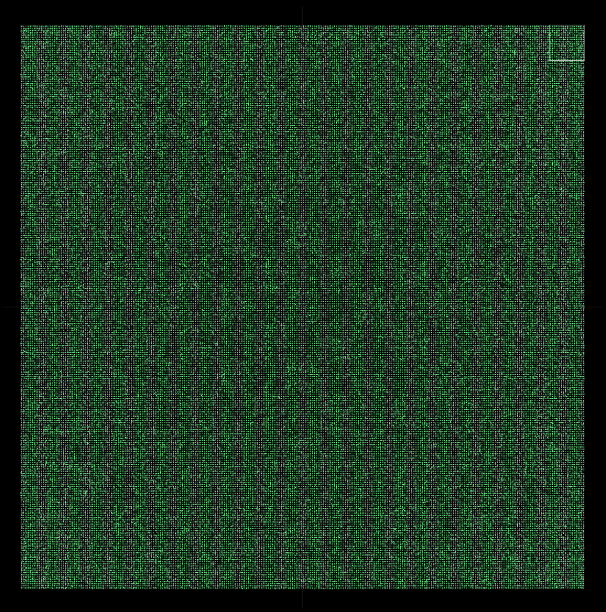
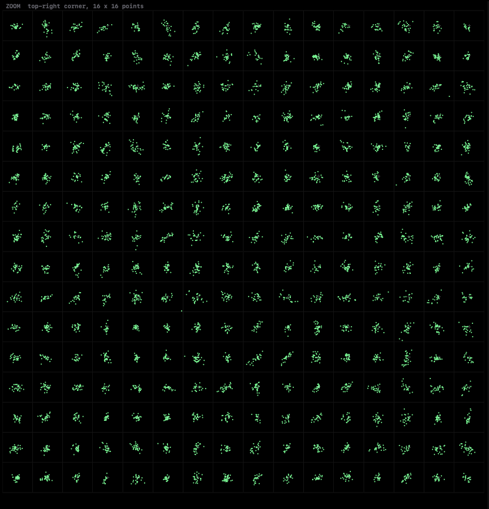

# 65536-QAM

A 65536-QAM signal in a 4 MB file, with the answer key, for anyone who wants to try demodulating it.

<p align="center">
  
  
</p>

*The level 1 signal from this repo, sent over coax into an RFSPACE NetSDR and demodulated in SpectraFlux. Left: all 65,536 points. Right: the top-right corner, 16 × 16 points, which is a complete 256-QAM constellation by itself.*

I posted a 65536-QAM constellation received on a stock Icom IC-R8600. Here's a signal to try, in four versions from easy to hard. They are computer-generated and have never been through a radio. Getting one through real hardware is the hard part, and that part is yours.

## The signal

| | |
|---|---|
| Modulation | 65536-QAM: a 256 × 256 square grid, 16 bits per symbol |
| Symbol rate | 12,000 symbols/s |
| Bit rate | 192 kbit/s |
| Pulse shape | root raised cosine, roll-off 0.35 |
| Bandwidth | 16.2 kHz |
| Sample rate | 192 kS/s, 16 samples per symbol (level 4: 250 kS/s) |
| Peak to average | 6.9 dB |
| Length | 65,600 symbols, 5.47 s (level 4: 8.2 s) |
| File | 16-bit WAV, I on the left channel, Q on the right, 4.2 MB (level 4: 8.2 MB) |

It holds a 64-symbol QPSK preamble and then every one of the 65,536 points exactly once, in scrambled order.

Levels 1 to 3 are each one seamless loop. The pulse shaping was done around the whole thing at once, so the end runs straight into the start. Play one on repeat and there is no glitch at the join. That also makes them easier than a real capture: a filter can wrap around the ends, and one FFT over the whole file finds the carrier exactly. Level 4 takes those shortcuts away.

## Files

| | |
|---|---|
| `65536qam_12k_192k.wav` | level 1: the clean signal |
| `65536qam_level2.wav` | level 2: carrier, timing and phase are off, but fixed |
| `65536qam_level3.wav` | level 3: they move, and there is an echo and noise |
| `65536qam_level4.wav` | level 4: level 3 as a capture, cut from a longer stream, at 250 kS/s |
| `symbols.csv` | the answer key: every symbol that was sent, in order |
| `demod.py` | a short demodulator for level 1 that counts the errors |
| `generate.py` | the script that made the files |

Both scripts need Python 3 and numpy.

## Try it

```
python3 demod.py
```

```
65536qam_12k_192k.wav: 1049600 samples at 192000 S/s, 65600 symbols
symbol errors: 0 of 65600
bit errors:    0 of 1048576
different points in the payload: 65536
MER: 104.1 dB
```

`demod.py` takes the easy way. It knows there is no carrier offset and that a symbol sits on every 16th sample starting with the first, so all it does is filter, pick samples, scale and decide. That is a few dozen lines. A real receiver has to find the timing, the carrier, the gain and which way up the constellation is, all by itself. That is the exercise.

## Four levels

All four files carry the same symbols, so `symbols.csv` is the answer key for each of them.

| File | What is wrong with it |
|---|---|
| `65536qam_12k_192k.wav` | Nothing. No carrier offset, and a symbol on every 16th sample. |
| `65536qam_level2.wav` | The carrier is off by some tens of hertz, the symbols fall between the samples, and the phase starts at an arbitrary angle. Nothing moves. |
| `65536qam_level3.wav` | The same kind of offsets, plus things that move: slow phase wander of about half a degree rms, the level drifting 0.1 dB either way, a weak echo 56 dB down, and noise for 60 dB MER. |
| `65536qam_level4.wav` | Level 3's troubles, in a capture. It is 8.2 s cut out of a longer stream, so it starts in the middle of a frame and of a symbol and it does not loop. The sample rate is 250 kS/s, which is 20.8333 samples per symbol, so symbols do not fall on samples. The carrier offset is not a whole number of turns in the file, so it does not land on an FFT bin. |

Those sound small. At this density they are not: half a degree is three times what a corner point tolerates, and 0.1 dB is four times.

`demod.py` gets nearly every symbol wrong on levels 2 and 3, which is the point, and it cannot read level 4 at all. All of them have been demodulated blind with every symbol right (level 3: 688,848 symbols over six passes of the file; level 4: all 162,539 symbols a block-by-block analyzer saw), so it can be done. The exact numbers are in `generate.py` if you want to cheat.

## Why it is hard

The points are close together. Half the distance between two neighbours is 0.48% of the signal's rms amplitude, which is 46 dB down. Anything that moves a symbol further than that puts it in the wrong box:

- At the corners of the grid, a phase error of 0.16 degrees is enough.
- So is a gain error of 0.28%.
- Noise has to be well below that. With plain Gaussian noise:

| MER | symbols wrong |
|---|---|
| 50 dB | 1 in 16 |
| 52 dB | 1 in 71 |
| 55 dB | 1 in 3,500 |
| 58 dB | 1 in 6.5 million |
| 60 dB | 1 in 40 billion |

One way to picture it: any 16 × 16 patch of this constellation is a complete 256-QAM constellation. The whole thing is 256 of them side by side.

## The format, exactly

**Samples.** Complex baseband, carrier at the centre of the file, 192,000 samples per second. Symbols are 16 samples apart and the first one is on sample 0. The largest I or Q sample is 1 dB under full scale.

**Filter.** Root raised cosine, roll-off 0.35, at the transmitter. Use the same filter in the receiver and the two together leave no interference between symbols. Because the file is a loop, the cleanest way to filter it is circularly (multiply in the frequency domain over the whole file), which is what `demod.py` does. If you read the file once and filter it the ordinary way, expect edge effects on the first and last dozen symbols, or append a copy of the start to the end.

**Constellation.** I and Q each take one of 256 levels: −255, −253, … −1, +1, … +253, +255.

**Bits to levels.** Each symbol carries a 16-bit word. The top eight bits pick the I level and the bottom eight pick the Q level, each Gray-coded so that neighbouring levels differ in one bit:

```python
def level(bits):          # eight bits in, level out
    n = bits
    n ^= n >> 1
    n ^= n >> 2
    n ^= n >> 4
    return 2 * n - 255
```

**Payload, symbols 64 to 65599.** A 16-bit shift register (x^16 + x^14 + x^13 + x^11 + 1, starting at 0xACE1) is clocked 16 times per symbol, and what it then holds is the word. That visits every word except zero exactly once, so zero is sent last:

```python
s, words = 0xACE1, []
for _ in range(65535):
    for _ in range(16):
        bit = (s ^ (s >> 2) ^ (s >> 3) ^ (s >> 5)) & 1
        s = (s >> 1) | (bit << 15)
    words.append(s)
words.append(0)
```

The order matters. A receiver takes its gain, carrier and timing from the points being used evenly, and a plain counter (0, 1, 2 …) would hold I still for 256 symbols at a time.

**Preamble, symbols 0 to 63.** QPSK on the four points (±147, ±147), which carry almost exactly the average power of the full grid, so the level does not step when the preamble comes round. The bits come from a 9-bit shift register started with all ones, two bits per symbol, first bit for I and second for Q, where 0 means +147 and 1 means −147:

```python
s, bits = 0x1FF, []
for _ in range(128):
    bit = (s ^ (s >> 4)) & 1
    s = (s >> 1) | (bit << 8)
    bits.append(bit)
```

The preamble gives a receiver the start of the frame, the gain and the phase, and with the phase which of the four possible rotations it is looking at.

**Answer key.** `symbols.csv` has one row per symbol: its number, I, Q, and for payload symbols the 16-bit word in hex.

**WAV header.** A normal 16-bit stereo WAV. It also has the `auxi` chunk that SpectraFlux, SpectraVue, CuteSDR and other SDR programs read for the centre frequency. That says 30 MHz, and it is only a label. Ordinary WAV readers skip the chunk.

## Things to try

- Demodulate level 1 without using the fact that a symbol sits on sample 0.
- Add noise until it breaks, and see how close you get to the table above.
- Resample it by a few parts per million, the way a receiver with its own clock would see it, and lock to that.
- Play it out of a DAC or a signal generator, receive it with a radio, and see what comes back.

## Where this came from

I was testing the vector analyzer in [SpectraFlux](https://rfspace.net), my SDR software for the Mac, and wanted to know how far it would go. Through a stock IC-R8600 at 30 MHz, over coax:

- 10,000 symbols/s: 468,183 symbols checked one by one against what was sent, with no errors, at 63 dB MER.
- 100,000 symbols/s: locked at 59.5 dB MER. That is 1.6 Mbit/s in 135 kHz.

Nobody transmits this. Cable modems stop at 4096-QAM, and most never get there. It was just to see.

Pieter Ibelings, N4IP

## Licence

MIT. Use the file and the scripts however you like.
